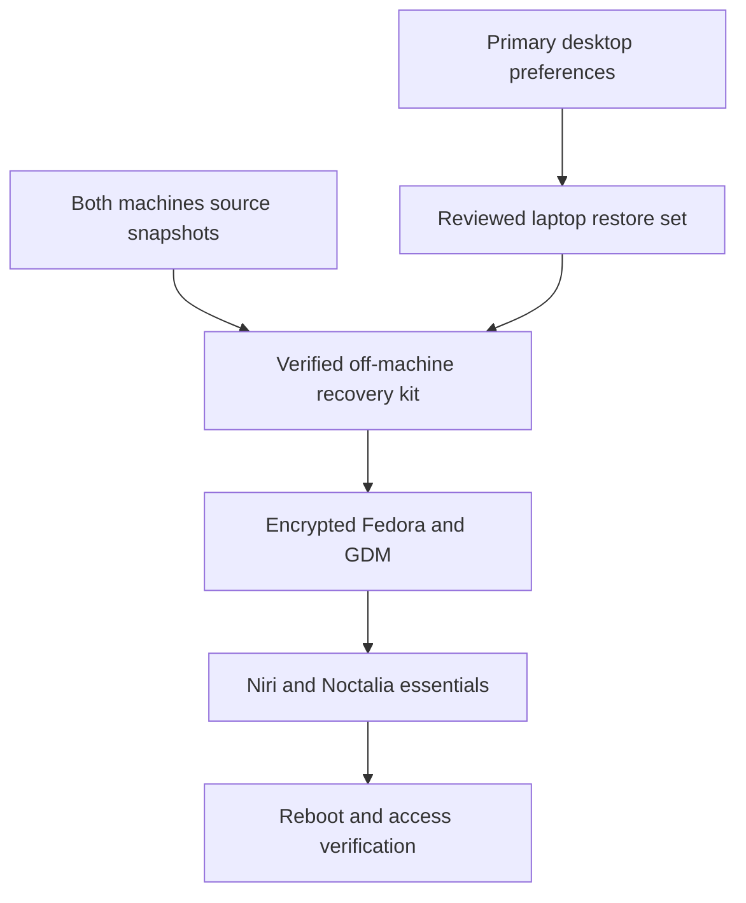

# Rebuild the Framework Laptop

## Overview

First bring the dotfiles repository up to date and make its laptop setup ready for reinstall. Then capture a small, verified recovery kit; reinstall standard Fedora Workstation with encrypted system/home storage; restore the niri, Noctalia, Ghostty, and zsh experience from `linux-server`, adapted for this laptop. Keep GDM and exclude the webview. Generate fresh SSH keys afterward.

This is a selective configuration migration, not a full home backup or a new provisioning framework. The existing machine remains usable until the recovery kit and installation media pass the pre-wipe gate. No installation or configuration changes have been performed during planning.

Origin: [rebuild requirements](../brainstorms/2026-11-03-encrypted-fedora-rebuild-requirements.md).

---

## Delivery Phases

1. **Get the dotfiles repo ready (U1–U2).** Audit live configuration and uncommitted work on both machines, reconcile relevant updates, capture portable desktop preferences in the repo, fix laptop defaults, and document and validate the minimal fresh-install path. This is the first independently reviewable deliverable.
2. **Make recovery independent of this machine (U3).** Preserve the prepared repository revision and any private assets off-machine, verify access without old SSH keys, and prepare installation media.
3. **Reinstall and restore (U4–U5).** Install encrypted Fedora, restore from the prepared repo, and verify the desktop and fresh SSH access.

**Phase 1 completion gate:** The reviewed repo contains the essential configuration and setup documentation, laptop rendering excludes the webview and custom greeter, required dependencies are listed, and the restoration preview passes. Record a committed recovery revision and verify it is available off-machine before treating the repository as reinstall-ready. An uncommitted working copy on this laptop is not sufficient. Any remaining private files are explicitly listed with their recovery locations; the private kit supplements the repo rather than substituting for missing tracked preferences.

---

## Requirements Trace

| Requirement | Delivery |
|---|---|
| R1: LUKS2 system/home; remove eCryptfs restriction | U4, U5 |
| R2: Primary machine's actual desktop essentials | U1, U2, U3, U5 |
| R3: Laptop hardware adaptation | U1, U2, U5 |
| R4: No webview or startup service | U2, U5 |
| R5: Default login screen with niri session | U2, U4, U5 |
| R6: Fresh SSH keys | U3, U5 |
| R7: Verified off-machine recovery material | U1, U3 |
| R8: Preserve uncommitted work; primary desktop intact | U1, U2, U3 |
| R9: Recovery checklist without old keys | U3, U4, U5 |

---

## Research and Decisions

- Both machines currently use GDM. Keep Fedora Workstation's GNOME session as a fallback and install niri alongside it; do not install a custom display manager.
- This machine is a Framework Laptop 16 with AMD integrated/discrete graphics. Use the existing `laptop` chezmoi profile, validating its internal output name, mode, and scale against the actual display. Do not install the desktop NVIDIA packages.
- `linux-server` is Fedora 44; the laptop reports Fedora 45. Verify the officially available supported stable Workstation release and compatible desktop packages when preparing media. The download page seen during research advertises 44, so do not infer media availability solely from the installed version.
- Primary `dotfiles` is a symlink to the chezmoi source. Snapshot the resolved working tree, not just the symlink. Both machines have uncommitted and untracked work; preserve independent snapshots before reconciliation.
- Primary Noctalia GUI overrides contain three desktop output names and wallpaper references. Capture sanitized portable preferences as a repo-managed laptop bootstrap seed, remapping the bar to the internal display. Include the selected wallpaper asset in the repo when suitable for publication, otherwise list it as a private recovery asset. Do not restore notification history or the whole runtime state directory.
- Reuse the existing laptop webview exclusion in `.chezmoiignore.tmpl`. Audit service-enable symlinks and other autostart sources too; excluded files alone do not prove the process cannot start.
- `run_once_install-sddm-noctalia.sh.tmpl` installs a custom greeter specifically for laptops. Change it to an explicit opt-in with a default of disabled. Existing primary desktop behavior remains GDM; restoration must never invoke `fix_sddm`.
- Restore from a reviewed working copy derived from the primary, not by overwriting either existing checkout. Preserve local-only work in the recovery kit without making it the desktop reference.
- Selectively apply desktop targets with scripts excluded; run only individually reviewed setup hooks. The repo also installs AI tools, Node versions, unrelated externals, and other services. A blanket init/apply would exceed scope.
- The primary's package inventory is a useful reference, not an installation list: it includes NVIDIA drivers, development stacks, and many unrelated applications. Build a short essentials list from retained startup commands, keybindings, and theme dependencies.
- No `docs/solutions/` directory was found locally. Existing patterns come from `README.md`, `DEPENDENCIES.md`, the niri/Noctalia templates, and chezmoi hooks.

---

## Implementation Units

### U1. Audit both machines for dotfiles updates

**Requirements:** R2, R3, R7, R8. **Dependencies:** none.

**Files:** Inspect `dot_config/niri/config.kdl.tmpl`, `.chezmoitemplates/nirimation/`, `dot_config/noctalia/`, `dot_config/ghostty/`, `dot_config/zsh/`, `dot_zshenv`, and both machines' Git changes. Create private recovery snapshots outside the repo; create `docs/fedora-laptop-recovery.md` for the sanitized inventory and final checklist.

**Approach:**

- Capture tracked changes, untracked source files, repository identity/revision, and resolved source trees for both machines. Detect nested repos and symlinks rather than silently assuming a source archive contains their targets.
- Inventory live managed-file drift on the primary without applying changes. Audit selected unmanaged desktop files, Noctalia GUI overrides, GTK/Qt settings, fonts, cursors, current wallpaper, and shell/terminal theme dependencies.
- Retain readable source files as well as Git patches so recovery does not depend on fetching a specific commit. Include the plan and requirements in the recovery kit.
- Inventory the laptop's display, touchpad, audio, networking, enabled user services, and session behavior. Identify any small local-only configuration worth retaining without expanding to bulk data.
- Inspect sensitive candidates privately; keep credentials, history, API environment files, and unrelated application state out of Git and out of the ordinary desktop restore set. Do not copy old SSH private keys.
- Observe the primary without editing, applying chezmoi, restarting services, or changing its user account. Use laptop-local staging for reconciliation.

**Verification:** Both source snapshots can be extracted, include uncommitted/untracked files, and match recorded checksums. The primary's original working-tree state remains intact. Selected live preferences have a documented source, dependency, and laptop adaptation.

**Test expectation:** No new automated tests; read-only inventory and archive verification.

### U2. Update the dotfiles repo and validate reinstall readiness

**Requirements:** R2, R3, R4, R5, R8. **Dependencies:** U1.

**Files:** Review/update `.chezmoiignore.tmpl`, `.chezmoi.toml.tmpl` if needed for the greeter opt-in, `run_once_install-sddm-noctalia.sh.tmpl`, `dot_config/niri/config.kdl.tmpl`, `dot_config/noctalia/`, `dot_config/ghostty/`, `dot_config/zsh/`, `dot_zshenv`, `dot_local/bin/`, `DEPENDENCIES.md`, and `docs/fedora-laptop-recovery.md`. Treat primary-only package manifests as source material, not files to assume exist locally.

**Approach:**

- Reconcile essential preferences into the staged source, preserving both originals. Gate custom greeter installation explicitly; render both laptop and desktop profiles to verify the gate and webview conditions.
- Bring relevant primary-machine repo updates and live-file drift into the reviewed repo changes. Preserve unrelated work in snapshots and report it separately rather than silently dropping it or mixing it into the laptop setup.
- Reuse laptop keyboard/touchpad/brightness handling. Confirm the internal output instead of assuming the template's `eDP-2` mode is still correct.
- Retain Noctalia v5 preferences with laptop output mapping; capture generated niri theme settings as reference and let restored Noctalia regenerate them. Store sanitized initial GUI preferences as a laptop bootstrap seed in `dot_config/noctalia/`, deployed only when the override file is absent so later GUI edits remain local. Exclude sensitive values and runtime state. Never impose the primary-monitor layout on the laptop or overwrite the primary's live overrides.
- Include Ghostty, zsh/Oh My Zsh and plugins, required fonts/cursors, launcher, portal/polkit support, clipboard, audio/brightness utilities, and helper dependencies needed by essential retained bindings. Include themes for retained programs when Noctalia references them.
- Audit every automatic startup entry. Omit webview, backup jobs, VNC, doorbell integrations, and unrelated tool hooks from the laptop restore selection unless needed for the agreed essentials. Guard shell startup integrations for tools deliberately not installed.
- Do not replay chezmoi's old script-state database; it could incorrectly suppress needed setup. Use a fresh state with individually selected, reviewed hooks and targeted file deployment.
- Preview all deployed targets and external downloads. Fetch only selected shell/theme dependencies; exclude unrelated externals such as Fabric from the minimal restore path.
- Update `README.md`, `DEPENDENCIES.md`, and `docs/fedora-laptop-recovery.md` so the prepared repo explains how to restore essentials on fresh Fedora. Review the final diff for secrets and unrelated edits, record the recovery commit, and verify its availability on the remote or in an off-machine repository copy. Do not reset or apply the reconciled source onto the primary machine.

**Verification scenarios:**

- Laptop render: expected touchpad/brightness behavior, valid internal output, no webview targets or enable links, no custom greeter invocation.
- Desktop render: primary desktop output preferences remain available; webview remains available for the primary.
- Fresh shell: opens with the intended theme and plugins even when development SDKs and AI tools are absent.
- Missing optional helper: its automatic startup is omitted or guarded; core terminal and launcher remain usable.
- Targeted dry-run: selected targets and reviewed dependencies only, with no unexpected service activation, display-manager changes, or unrelated tool installation.
- Fresh Noctalia setup: the laptop seed creates the intended initial preferences; an existing GUI override file is preserved on subsequent applications.
- Repository recovery: a clean checkout or extracted copy of the recorded revision contains all documented public configuration and bootstrap files; private dependencies are explicitly enumerated.

**Test expectation:** Configuration rendering, syntax validation, and staged previews; no implementation-mirroring test suite.

### U3. Assemble and verify recovery access before wiping

**Requirements:** R2, R6, R7, R8, R9. **Dependencies:** U1, U2.

**Files:** Complete `docs/fedora-laptop-recovery.md`; store private recovery artifacts outside Git.

**Approach:**

- Keep the main recovery kit on `linux-server` in a private location, with a second portable copy on separate USB storage or another verified off-machine destination. Creating that copy is execution work; none exists yet.
- Choose an access route that needs no old laptop private key: prepare the new SSD contents from locally accessible removable recovery storage. If the recovery archive is encrypted, store its passphrase independently and prove it can be opened from the live environment.
- Confirm James can log into the primary machine and access GitHub independently of this laptop, including any password-manager or MFA prerequisites. Never put account recovery secrets into the public checklist.
- If `linux-server` is reachable only through a VPN/tailnet, include the reconnection prerequisite in the checklist; do not rely on hostname resolution or old SSH authentication to bootstrap restoration.
- Include the curated source tree, selected private preference seeds, necessary assets, dependency checklist, recorded versions/repositories, known-good hashes, installation notes, and source snapshots. Preserve archive metadata and executable bits.
- Prepare verified official Workstation installation media. Ensure installation and recovery storage are distinct, and prove Wi-Fi/Ethernet, keyboard, display, and access to the recovery kit from the live session.
- Record the physical internal SSD model/serial/size and map it to the installer target. The inspected layout has a roughly 1 TB NVMe with shared root/home Btrfs; device names may change in the live session.

**Pre-wipe gate:** The user can read the checklist off-machine; the kit extracts successfully; selected assets and source changes are present; media boots and networking works; compatible essentials packages are available or staged; recovery does not require old keys; the user explicitly confirms the physical disk and its erasure. If any item fails, keep the existing installation.

**Verification:** Rehearse extraction into a temporary directory and compare checksums. Confirm sufficient storage and recovery credentials independently of the laptop. No full-home backup is promised.

### U4. Reinstall encrypted standard Fedora Workstation

**Requirements:** R1, R5, R9. **Dependencies:** U3 and explicit disk-erasure confirmation.

**Files:** Follow and annotate `docs/fedora-laptop-recovery.md`; no repo application changes in this unit.

**Approach:** The user performs the physical installer steps. Use the verified Workstation image, erase only the confirmed internal target, select encryption for the system/home storage, and keep the default Btrfs layout and GDM. Retain username `james` to minimize path adaptation. Store the encryption passphrase independently of this disk. Do not restore the old eCryptfs directory tree or PAM mounting setup.

EFI and potentially boot files remain outside encryption in the standard boot layout; the requirement is encryption of system and home data, not every boot-sector byte. Verify the installer's final storage summary before committing changes rather than depending on a particular checkbox label.

**Verification:** First boot unlocks the encrypted volume; root and home resolve through a LUKS2 mapper; GDM and the GNOME fallback work; networking is available. Stop here to repair the base system if these checks fail.

**Recovery limit:** Before erasure, abandon the rebuild and keep using the old system. After erasure there is no full-system rollback; recovery is a fresh installation plus the verified selected artifacts.

### U5. Restore essentials, authorize new keys, and verify after reboot

**Requirements:** R1–R6, R9. **Dependencies:** U4 and accessible U3 recovery kit.

**Files:** Use reviewed U2 targets and finalize verification results in `docs/fedora-laptop-recovery.md`.

**Approach:** Install the verified essentials list, restore staged preferences selectively, and run only reviewed prerequisite hooks. Use the niri session integration supplied by its package so GDM launches the correct session environment. Keep GNOME available while validating niri.

Generate a new passphrase-protected SSH key on this installation. Use the primary machine to add only its public key to the intended server account and GitHub account. Verify server host fingerprints through the primary machine; do not suppress host checking or copy private keys between machines. Repository recovery itself must already work through the portable kit.

**Acceptance checklist:**

- Cold boot prompts for volume unlock; both root and home are under LUKS2, with no eCryptfs mount. A 255-byte ASCII filename can be created and removed in home.
- GDM offers niri; login, logout, and reboot work, with GNOME still available for recovery.
- Ghostty opens with the primary's selected theme/fonts; zsh starts with expected plugins and no missing-file errors.
- Core tiling/workspace bindings, launcher, clipboard, screenshots, audio, brightness, touchpad, notifications, wallpaper, locking/unlocking, and suspend/resume work.
- Noctalia bar appears on the laptop display with the intended preferences; it has no dependency on missing desktop outputs or absent wallpaper files.
- No webview process, installed user unit, enable symlink, or autostart entry exists after reboot. Unrelated backup/remote-access jobs are not inadvertently enabled.
- Fresh keys authenticate to the intended server and GitHub; no old private key was restored.
- Primary desktop and working-tree state remain unchanged. Record restored revision, package versions, deviations, and any optional tools left for later.

**Test expectation:** Real desktop acceptance checks; no automated hardware or disk-erasure test suite.

---

## System Impact and Failure Handling

The primary is a read-only source during capture. Reconciliation happens in a separate working copy. A later laptop apply touches only the reviewed targets; it must not globally run repository hooks or enable copied services. A failed snapshot, authentication prerequisite, download, or dry-run blocks the wipe gate. A failed niri restoration falls back to GNOME for diagnosis. Keep the recovery kit until all acceptance checks pass.

---

## Risks and Execution-Time Questions

| Risk or pending detail | Treatment |
|---|---|
| Unmanaged GUI changes or broken source symlinks | Audit live selected targets and archive resolved source; verify extraction before wipe. |
| GDM replaced by laptop hook | Add default-off greeter opt-in before restoration and inspect hook preview. |
| Desktop display names copied to laptop | Remap niri and Noctalia output settings together; validate on actual hardware. |
| New SSH keys cause recovery deadlock | Recover from removable storage first; primary authorizes new public keys afterward. |
| Repo/source archive contains secrets | Review privately, restrict recovery storage permissions, and publish only sanitized changes. |
| Current package sources change | Verify niri, Noctalia v5, Ghostty, launcher, and shell prerequisites for the selected Fedora release before erasure; record versions and repo provenance. |
| Recovery destination/media not chosen yet | Select and test during U3; their absence blocks erasure, not preparation. |
| Laptop output naming or optional integrations differ | Determine during U1/U2; preserve essentials and guard absent optional integrations. |

No product decisions remain before preparation. Exact capture contents, media destination, package availability, and physical disk identity are execution checks that must pass before erasure. Full home recovery, all apps, development stacks, and broad workstation automation remain outside scope.

Preparation can proceed without approving erasure. Completing U1–U3 produces the concrete recovery kit and installer target for review; it does not authorize U4. The user will need access to the primary machine and physical access to the laptop and removable media across the reinstall, because this agent session will not survive it automatically.

---

## Sources

- [Origin requirements](../brainstorms/2026-11-03-encrypted-fedora-rebuild-requirements.md).
- Repo: `README.md`, `DEPENDENCIES.md`, `.chezmoiignore.tmpl`, `.chezmoiexternal.toml`, `run_once_install-sddm-noctalia.sh.tmpl`, `dot_config/niri/config.kdl.tmpl`, `dot_config/noctalia/config.toml`, `dot_config/zsh/dot_zshrc`.
- [Fedora disk encryption guide](https://fedoraproject.org/wiki/Disk_Encryption_User_Guide): installer encryption and block-device scope; verify exact current installer UI during preparation.
- [Official Workstation downloads](https://fedoraproject.org/workstation/download/): release/media selection and verification.
- [niri getting started](https://github.com/niri-wm/niri/wiki/Getting-Started): display-manager and session integration.
- [chezmoi apply](https://www.chezmoi.io/reference/commands/apply/) and [script behavior](https://www.chezmoi.io/user-guide/use-scripts-to-perform-actions/): previews and excluding scripts.
